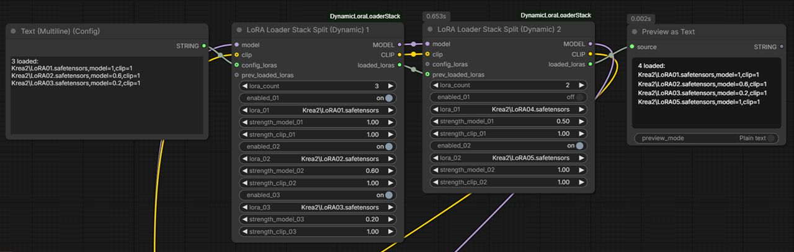

# Dynamic LoRA Loader Stack

A ComfyUI custom node pack in the spirit of **Lora Loader Stack (rgthree)**: several LoRA dropdowns in one node, with model and clip in and out.

You can **toggle each LoRA on or off without setting it to None**, and set a **dynamic number of LoRA slots** (1–50, default 5).



Two nodes ship together. One install from ComfyUI Manager gives you both.

| Node | Strength |
| --- | --- |
| **LoRA Loader Stack (Dynamic)** | One `strength_NN`, applied to both model and CLIP |
| **LoRA Loader Stack Split (Dynamic)** | Separate `strength_model_NN` and `strength_clip_NN` |

## Features

**Toggle a LoRA on or off without setting it to None.**  
Each slot has an `enabled_NN` checkbox. Uncheck it to skip that LoRA. The dropdown and strengths stay as they are, so you can turn it back on without picking the file again.

**Dynamic number of LoRA slots.**  
Type a count in `lora_count`. Default is **5**, range is **1–50**. The node shows only that many selectors and hides the rest. Lowering the count does not wipe the hidden slots.

Also:

- Numbering starts at `01`.
- Strength range **-100 to 100**, step `0.01`, same as the official Load LoRA node.
- `clip` is optional. Leave it disconnected to patch the model only.
- `loaded_loras` is a text summary of what was actually applied.
- Chain nodes by wiring the previous `loaded_loras` into the next `prev_loaded_loras`. The last output lists the whole chain.
- `config_loras` is an optional preset input string in the same format as `loaded_loras`. When wired, it configures which LoRAs and strengths to apply for this node instead of using the manual slot widgets.

## Install

1. Copy the `ComfyUI-InputThumbnails` folder into:

   `ComfyUI/custom_nodes/ComfyUI-InputThumbnails`

2. Restart ComfyUI.

## Slot layout

Single strength:

```
enabled_01
lora_01
strength_01
```

Split strength:

```
enabled_01
lora_01
strength_model_01
strength_clip_01
```

A slot loads only when it is within `lora_count`, enabled, not `None`, and at least one strength is non-zero.

## `loaded_loras` & `config_loras` format

Single strength:

```
2 loaded:
lora03.safetensors,strength=2
lora04.safetensors,strength=-20
```

Split strength:

```
2 loaded:
lora01.safetensors,model=1,clip=1
lora02.safetensors,model=1.2,clip=1.5
```

Wire `loaded_loras` to a Show Text node if you want to see it, or leave it disconnected if you do not.

### Preset Input (`config_loras`)

You can wire a string in `loaded_loras` format into `config_loras` to drive the node like a preset:
- **Format Interoperability**:
  - The Single Strength node accepts both formats (if split format `model=X,clip=Y` is provided, it uses the strength from `model`).
  - The Split Strength node accepts both formats (if single format `strength=X` is provided, it assigns both model and CLIP the same value).
- **Validation**: The input is strictly validated before execution. If the header count does not match the number of LoRA lines, if lines are malformed, or if strengths are invalid/out of range, an error is raised and the workflow will not run.
- **Security**: LoRA names are strictly inspected to disallow directory traversal (`..`), absolute paths, null bytes, and dangerous injection characters.
- **Missing LoRAs**: If a LoRA in the preset is not installed, it is safely skipped.
- **UI Synchronization**: Connecting a preset string (from a Primitive or Text node) or running the workflow automatically updates the node widgets (`lora_count`, dropdown selectors, and strength values) on the canvas to match the preset.
- **Context Menu Options**: Right-clicking the node provides **"Apply Preset from Clipboard"** and **"Apply Preset from Text..."** to quickly populate node widgets directly from copied presets.

## Security

This pack does not make network calls, run shell commands, read environment variables, or touch files outside ComfyUI's normal LoRA loader. It only calls ComfyUI's `LoraLoader` with names from your `models/loras` folder. Input presets (`config_loras`) and chained stack summaries (`prev_loaded_loras`) are strictly sanitized against path traversal, control characters, and command injection.

## License

[GPL-3.0-or-later](LICENSE.txt). See [`LICENSE.txt`](LICENSE.txt).

